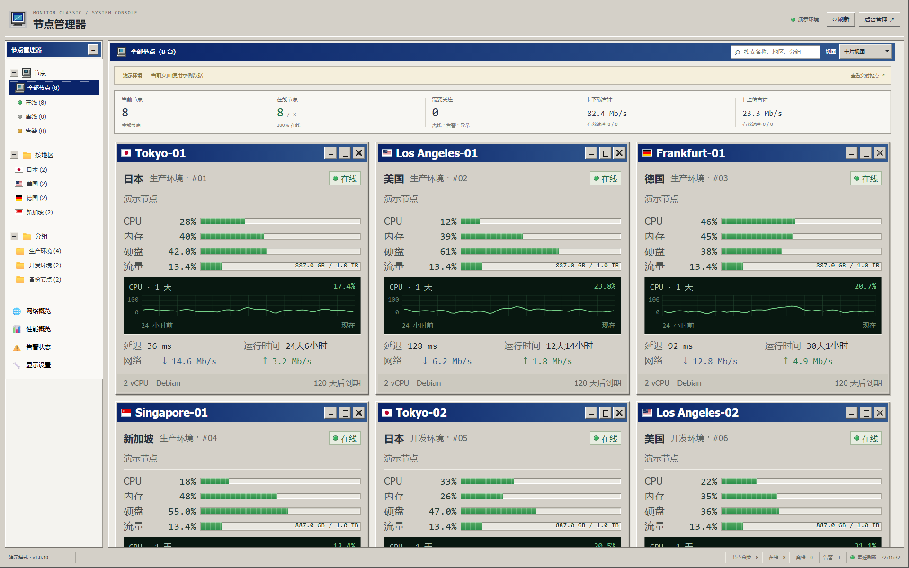
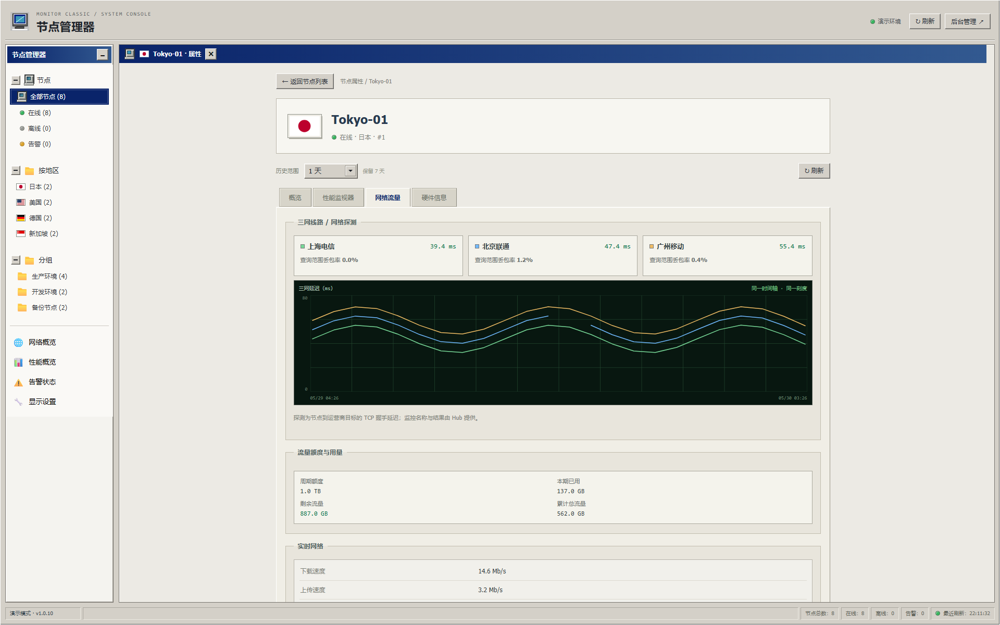

# Monitor Classic · 经典监控台

面向 [Monitor](https://github.com/monitor-probe/monitor) Hub 的独立中文主题，采用 Windows 95/2000 控制台风格：蓝色标题栏、立体边框、资源进度条、性能曲线与可折叠导航树。

[下载 v1.0.10](https://github.com/ayingQAQ/monitor-theme-classic/releases/tag/v1.0.10) · [官方主题规范](https://monitor-document.pages.dev/dev/theme) · [主题收录要求](https://github.com/monitor-probe/themes#收录你的主题)



## 安装

在最新版 Monitor Hub 后台「主题」→「从 GitHub 安装」填写：

```text
https://github.com/ayingQAQ/monitor-theme-classic
```

安装后选择 **Monitor Classic**。也可从 Release 下载 `theme.tar.gz` 上传安装。不要上传 GitHub 自动生成的源码 ZIP。

页面入口为 `/`，节点详情为 `/#/node/{id}`，采用 hash 路由，不需要额外放行服务器路径；`/admin` 由 Hub 后台处理。

- 主题名称：`Monitor Classic`；短名：`monitor-classic`；版本：`1.0.10`。
- 后续更新从清单 `url` 指向的仓库读取最新正式 Release。
- 开发阶段的 `x86-monitor` 使用不同短名，请安装新的 `monitor-classic`，不会自动覆盖旧主题。
- 登录、节点管理和探测任务由 Hub 后台提供。

附件 `theme.tar.gz.sha256` 用于校验：

```powershell
Get-FileHash .\theme.tar.gz -Algorithm SHA256
Get-Content .\theme.tar.gz.sha256
```

```bash
sha256sum -c theme.tar.gz.sha256
```

## 功能

- 桌面默认三列、卡片等比缩放。节点管理器默认展开，节点、地区和分组文件夹可独立收起。
- 页头电脑图标控制侧栏；卡片角标采用经典像素线条，手机上保留触摸范围并缩小可见按钮。视图选择使用主题内下拉菜单，支持触摸与键盘操作。
- 标题沿用 Tahoma 字形，中文使用明确的系统字体回退，数值使用紧凑等宽字体；只读取设备本地字体。手机版页头提供“后台管理”入口。
- 在线状态、地区、分组筛选，名称搜索、紧凑视图、卡片最小化与恢复。
- 本地 SVG 国旗覆盖全部 249 个 ISO 国家/地区代码及 7 个额外代码，包含冰岛；图案完整显示，不依赖外部图片服务。来源与许可证见 [THIRD_PARTY.md](THIRD_PARTY.md)。
- CPU、内存、硬盘、流量进度、剩余/额度、延迟、运行时间、实时网速。
- 独立节点详情：概览、性能监视器、网络流量、硬件信息。
- 性能监视器中 CPU、内存和硬盘历史各占一整行。
- 三网延迟使用同一时间轴和毫秒刻度，显示最新延迟及查询范围丢包率。运营商按 Hub 的探测名称识别；需要配置对应电信、联通、移动探测，未配置时明确提示。
- 文本/gzip WebSocket 串行解压、断线重连、轮询兜底，页面返回前台时恢复同步。
- 实时更新保留滚动容器和卡片，历史查询最多四个独立并发请求；优先加载当前可见卡片，资源与延迟结果各自返回后立即显示。限流时自动短暂重试，刷新时保留已有曲线。
- 历史未变化时复用已有 SVG；地区与时间格式器缓存复用，图表缓存使用弱引用或数量上限，减少重复计算和内存累积。
- 离线、等待首次上报、指标异常、加载、无历史、请求失败分别显示；缺失数据用 `N/A`。
- 剩余流量用额度减去 Hub 的计费用量 `month_used`，累计总流量取 Hub 累计接收与发送统计；支持不限量与超额状态。
- 历史范围跟随 `history_days`，时间戳定位曲线，缺失区间保留断点。节点名称、备注、公告和探测名称安全转义。

### 网络详情



截图使用明确标记的演示数据，不对应真实服务器。电脑预览为 **1920×1200（16:10）**，保持原始比例。

## 发布与收录

公开仓库根目录提供 MIT `LICENSE`；清单 `url` 指向本仓库；版本 `1.0.10` 对应 `v1.0.10` tag。正式 Release 附件为 `theme.tar.gz` 与 `theme.tar.gz.sha256`，包内含 `preview.png`。

按 [主题列表 README](https://github.com/monitor-probe/themes#收录你的主题) 申请收录时，只在 `themes.txt` 末尾增加本仓库地址；名称、简介、作者、版本和截图从最新正式 Release 读取。官方 PR 检查会将包安装进最新版 Hub。

CI 执行类型、格式、单元、浏览器和安装包检查；`Verify published release` 工作流使用官方主题列表检查器下载本仓库正式 Release，验证真实 Hub 安装。模拟接口回归不能替代真实 Hub 验收。

## 结构与许可证

`src/api.ts` 处理协议和连接，`format.ts` 处理状态/数值，`chart.ts` 绘制 SVG，`dom.ts` 保留节点并更新变化内容，`main.ts` 组织页面，`config.ts` 读取清单。演示入口与生产入口单独构建。运行时不依赖外部 UI 库、字体或图标服务。

对照官方主题指南与架构协议的检查记录见 [协议与接口核对](docs/protocol-audit.md)。

采用 [MIT](LICENSE) 许可证，第三方说明见 [THIRD_PARTY.md](THIRD_PARTY.md) 与 [THIRD_PARTY_NOTICES.txt](THIRD_PARTY_NOTICES.txt)。不包含微软专有图形素材，不属于微软官方产品。


